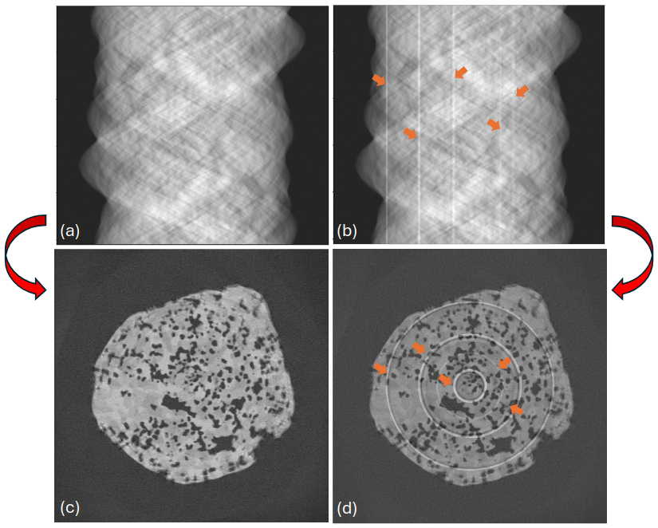

(rings)=
# Rings methods

Ring artifacts are one of the most ubiquitous types of artifacts present at tomographic reconstructions
and can present quite a challenge when it comes to analyzing and segmenting tomographic images. 
Here you will find examples of usage of the algorithms implemented in the package `sscRaft`.

## Rings artifacts

Rings artifacts are exactly what the name suggests: they appear as rings at the reconstruction level, as shown in Figure 1. 
They occur when the measured data present stripes artifacts in its acquisition. These stripes have different categories and are thoroughly discussed at the work 
[Nghia T. Vo et al (2018)](https://doi.org/10.1364/OE.26.028396), just as in the [sarepy](https://sarepy.readthedocs.io/toc/section2.html) documentation pages.

|  | 
| :-------: | 
| Figure 1: **(a)** Sinogram of a demonstration phantom; **(b)** sinogram in (a) corrupted by vertical stripes; **(c)** reconstruction of sinogram in (a); **(d)** reconstruction of sinogram in (b).| 

## All Stripes Method

The _all stripes_ algorithm applies a sequence of processing stages that act on some specific categories of stripes in order to mitigate them.

Macul, L. and Miqueles, E.X. (2025). Accelerating Tomographic Artifact Removal Using a Multi-GPU System. Communications in Computer and Information Science, vol 2270. Springer, Cham. [DOI](https://doi.org/10.1007/978-3-031-80084-9_1).

The input and output data is on the following format:

- ``tomogram``: Three-dimensional tomogram data. The axes are ``[slices, angles, rays]`` in python syntax.
- ``output``: Corrected three-dimensional tomogram data. The axes are ``[slices, angles, rays]`` in python syntax.

```python
    import numpy
    import sscRaft

    '''Load data-set
    tomogram = ...
    '''

    output = sscRaft.rings_remove_all_stripes(tomo, ngpus = 1, settings = { 'size_median': small_to_median_stripes_size,
                                                                            'large_stripes_size': large_stripes_size,
                                                                            'background_ratio': background_ration,
                                                                            'drop_ratio': drop_ratio,
                                                                            'dim':1})
```

The reference to all the input parameters can be found on the {ref}`All Stripes API documentation <apiallstripes>`.


## All Stripes Multiaxis Method

The input and output data is on the following format:

- ``tomogram``: Three-dimensional tomogram data. The axes are ``[slices, angles, rays]`` in python syntax.
- ``output``: Corrected three-dimensional tomogram data. The axes are ``[slices, angles, rays]`` in python syntax.

```python
    import numpy
    import sscRaft

    '''Load data-set
    tomogram = ...
    '''

    output = sscRaft.rings_remove_all_stripes_multiaxis(tomo, ngpus = 1, settings = {   'size_median': small_to_median_stripes_size,
                                                                                        'large_stripes_size': large_stripes_size,
                                                                                        'background_ratio': background_ration,
                                                                                        'drop_ratio': drop_ratio,
                                                                                        'dim':1})
```

The reference to all the input parameters can be found on the {ref}`All Stripes Multiaxis API documentation <apiallstripesM>`.


## Titarenko Method

This method is based on E. X. Miqueles, J. Rinkel, F. O'Dowd and J. S. V. Bermúdez 2014 paper, _Generalized Titarenko's algorithm for ring artefacts reduction_, [DOI](https://doi.org/10.1107/S1600577514016919).

The input and output data is on the following format:

- ``tomogram``: Three-dimensional tomogram data. The axes are ``[slices, angles, rays]`` in python syntax.
- ``output``: Corrected three-dimensional tomogram data. The axes are ``[slices, angles, rays]`` in python syntax.

```python
    import numpy
    import sscRaft

    '''Load data-set
    tomogram = ...
    '''

    output = sscRaft.titarenko_rings(tomogram, dic = {'gpu': [0,1], 'regularization': -1, 'blocks':1})
```

The reference to all the input parameters can be found on the {ref}`Titarenko API documentation <apititarenko>`.
